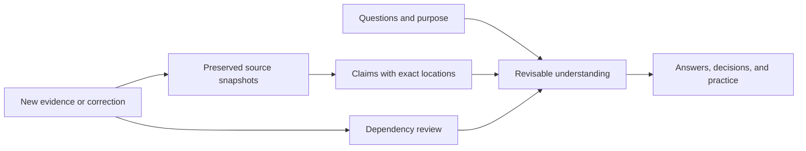

# Knowledge Compiler

**Give an agent a body of understanding it can return to, inspect, and revise.**

Knowledge Compiler turns a growing collection of sources into a maintained Markdown wiki: linked explanations, source claims, open questions, and decisions, with a route back to the evidence behind them. A later agent can pick up the inquiry, see what remains unfinished, and work out what needs to change when new evidence arrives.

I built and iterated this with Claude Code and Codex, starting from [Andrej Karpathy’s LLM Wiki idea](https://gist.github.com/karpathy/442a6bf555914893e9891c11519de94f). I have applied the compiler lineage to personal archive work, research into working with AI, and subject wikis, while comparing and reconstructing the reusable template itself. This edition is the September 2026 Astra reconstruction of the Fable-era template and its subsequent v3 working tree.

The result is a reusable template, a small Python toolkit, and a worked example you can inspect. The source collections from my private projects stay private.

[See a correction propagate](examples/lumen/README.md) · [Try it](#try-it) · [Inspect the design](docs/ARCHITECTURE.md) · [Read the validation record](docs/VALIDATION.md)

## The problem shows up on the second visit

An agent reads some material, explains it well, and helps you reach a useful conclusion. Next month, you return with another question. Which parts of that explanation came from the sources? Which were the agent’s interpretation? Did a later correction change the conclusion? Where did the previous session stop?

A useful working memory has to retain those distinctions. Otherwise, yesterday’s plausible answer becomes today’s undocumented premise.

The compiler maintains two things together: an account of what the sources say, and a revisable account of what follows from them. It organizes that work around questions you expect to revisit. New material can change an existing explanation, qualify a decision, open a question, or add supporting evidence without producing another essay.

The next session starts from a small index and follows the relevant pages back to decisive passages. Direct access to the raw sources remains available throughout.

## A correction with somewhere to go

The included **Lumen** example is entirely fictional.

A pilot reports that Recall Cards take **four minutes**, compared with **eight minutes** for Case Notebook. Both score **54 out of 60** on exact definitions. A newsletter repeats the result and makes a much broader promise.

Then a correction arrives: the Cards figure omitted **six minutes of setup**. The comparable totals are ten minutes versus eight.

The arithmetic takes a moment. Finding the conclusions that depended on the old arithmetic is the maintenance work.

In the completed example, the agent:

- preserves the original snapshots and previously issued source claims;
- adds the correction as new evidence and withdraws the time-saving rationale;
- updates the decision page, source notices, and index;
- retains the unchanged accuracy result and the limits of the study;
- recognizes that the newsletter repeats the same evidence, rather than treating it as another study.

The revised answer does not turn a reversed timing comparison into a universal winner. It explains exactly which reason for a recommendation has disappeared.

Read the [initial answer](examples/lumen/initial-answer.md), the [correction](<examples/lumen/raw/04 Timing Correction.md>), and the [revised answer](examples/lumen/correction-answer.md). Then inspect the files yourself:

```sh
python tools/kc.py --root examples/lumen check
python tools/kc.py --root examples/lumen impact "Definition Pilot#S1"
```

`impact` returns linked pages that may need review. The agent must still inspect them and search for uncited copies of the old conclusion.

## How the system works

The division of labor is deliberate: an agent reads, reasons, and edits; ordinary code checks the things that can be checked mechanically.



| Part | Responsibility |
| --- | --- |
| `raw/` | Preserve source snapshots. A correction is a new file. |
| Source pages | Record what a source says, its reading coverage, exact locations, and stable claim references. |
| Notes, questions, decisions, and practices | Develop interpretations, alternatives, implications, and conditions that would change a view. |
| `wiki/index.md` | Route the next question to the few pages worth reading. |
| `wiki/_state.md` | Record unfinished work so another session can resume against the actual files. |
| `tools/kc.py` and `.kc/` | Check structure and accepted evidence records; search the corpus; expose possible correction impact. |

A citation such as `[[Definition Pilot#S1]]` points to a specific source claim with a locator into the raw snapshot. Once sealed, edits to the accepted claim block trigger an integrity error. A correction gets a new claim and an explicit notice.

SHA-256 fingerprints and additive integrity records detect changes to accepted source bytes and claim blocks. They do not establish that a source is true. That distinction is part of the architecture: a green check cannot settle an argument.

The files remain ordinary Markdown. Obsidian is optional. The toolkit uses Python’s standard library; it needs no database, embedding service, or model API integration. You bring an agent with access to the folder.

## What I built with agents

Karpathy supplied the high-level pattern. My work has been taking that pattern through implementation, use, comparison, and reconstruction for the kinds of inquiry I actually pursue.

I set the purpose and priorities, brought the source material and recurring questions, and directed successive attempts. I asked agents to compare implementations, verify whether outside ideas added value, and preserve useful work while reconsidering the architecture. Agents contributed substantial research, design, code, documentation, and testing. The implementation reflects that collaboration.

The latest reconstruction began with a concrete audit. Among the findings: changed source bytes could leave the checker’s exit status successful; an issued claim could be reassigned without a persistent identity record; advertised tests were missing. The reconstruction turned those gaps into executable checks and regression cases.

It also reduced the mandatory page types from seven to five, added correction-impact tracing, made unfinished work visible, and supplied a factory for creating clean instances. A review caught a factory bug that could copy a personalized charter and log into a new project; the helper was changed to generate pristine versions, with a regression test for that failure.

That development loop matters to me: give agents a substantive problem, let them contribute implementation judgment, inspect what they produce, and use failures to improve the reusable system. The [prior audit](docs/PRIOR_AUDIT.md), [change record](CHANGELOG.md), and [validation report](docs/VALIDATION.md) make this particular loop inspectable.

## Where I use the approach

The template is shared machinery. Each instance needs its own purpose and standards of evidence.

**Personal archive compilation.** I use an Astra-derived instance to work with selected conversations and notes: recover questions, trace changes in thinking, and prepare context for future collaboration. Speaker, date, reading coverage, and the difference between my words and an agent’s interpretation matter here. A past conversation can inform a present inquiry without becoming a permanent verdict about me.

**Working with AI.** Another Astra-derived instance compiles practitioner material into a library of methods, explanations, and adaptable starting prompts. It keeps an author’s report, a proposed adaptation, a local test, and evidence of my own learning distinct. The library serves both me and agents helping with later work; it also supports separate practice sessions.

**Health education research.** An Astra-derived compiler reconstructs arguments from selected source material and supports targeted evidence appraisal. The key separation is between explaining an author faithfully, checking an empirical claim, and deciding what could support an original educational piece. This is ongoing research and preparation.

**Contemplative and philosophical wikis.** Earlier instances in the same compiler lineage organize teachings, arguments, and practice instructions. These require attention to the source’s conceptual framework and to differences between interpretation, instruction, and reported experience. They helped establish the broader range of work I wanted the reusable template to serve.

These are uses across my own projects. The public demonstration uses fictional records so the method can be examined without exposing private conversations or reproducing those source collections.

## Try it

Use **Python 3.10+** and an agent that can read and edit local files. From this template’s root, create a new instance at a destination that does not already exist:

```sh
python tools/new_instance.py ../my-knowledge
```

The factory copies the operating files and creates a fresh index and log. It refuses an existing destination or a populated source template.

Add one or two source snapshots to the new instance’s `raw/` directory. Keep original PDFs and images alongside extracted text where relevant. Open the instance with your agent and ask:

> Read AGENTS.md. This project is for [purpose]. I expect to revisit [questions]. Read these sources, preserve what they actually say, and build only the pages that help with those questions. Answer [a real question]. Tell me what changed in our understanding and what remains unresolved.

Run `python tools/kc.py check` from the instance root. After reviewing new source claims, the write workflow is **check → seal → check**: inspect the work, add its integrity records, and verify the resulting state.

The [agent contract](AGENTS.md), [workflows](docs/WORKFLOWS.md), and [schema](docs/SCHEMA.md) carry the operating detail. Existing instances should consult the [migration guide](docs/MIGRATION.md).

## What the evidence supports

The September development record reports **55 software tests passed and three Windows symlink tests skipped**. The Lumen example demonstrates a completed source correction, and a separate staged interruption exercises recovery in a fresh agent session. The [validation report](docs/VALIDATION.md) records the exact conditions and limitations.

The small development comparison also produced correct substantive answers from the earlier template and from raw sources plus search. It established no general advantage in answer quality or total cost. The checker verifies structure and recorded integrity; evidence quality and interpretation still require judgment.

This template is intended for modest, repeatedly revisited collections with one writer at a time. Compilation earns its upkeep when retained explanations, questions, and corrections help later work. For a one-off question, direct source reading may be all you need.

**The unresolved test is whether maintaining that understanding returns more value than it costs.** The repository gives you a concrete system with which to make that comparison.
