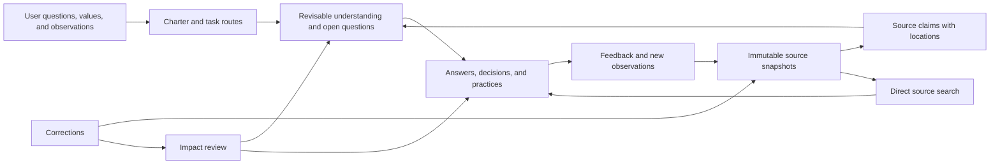

# Architecture and design judgment

## The question, sharpened once

The ambition is to extend the user's understanding, wisdom, epistemic rationality,
and reach through a reusable knowledge architecture. The consequential assumption
to reject is that storing more model-written synthesis necessarily advances those
ends. A polished wiki can compound a mistaken interpretation just as efficiently.

**Design brief:** build the smallest maintainable system that helps a fresh agent
recover warranted understanding, test competing interpretations, revise downstream
conclusions, and support the user's decisions and practice across recurring work.
Preserve ambitious inquiry and original thought; make their status and revision
conditions visible. Measure usefulness against the previous template and raw search.

This changes the success criterion from architectural completeness to useful judgment
and learning with tolerable upkeep. It does not redefine wisdom as a benchmark score.
No universal optimum across all purposes is assumed. Each instance supplies its own
questions, values, evidence standards, and constraints through a short charter.

## Commitment

Use a **source-grounded, question-driven Markdown wiki with selective compilation**.
Keep direct source retrieval available. Add small, deterministic tools for failures
that prose instructions cannot reliably catch. Let the agent do reasoning, including
creative synthesis, rather than forcing thought into a comprehensive database schema.

The feedback arrow means the user can bring back outcomes. It does not authorize
background surveillance, automatic external actions, or a conclusion that a reported
experience establishes a general causal law.

## Four responsibilities, three storage areas

| Responsibility | Location | Owner and invariant |
| --- | --- | --- |
| Evidence | `raw/` | Preserve snapshots; replacements are new files |
| Working understanding | `wiki/` | Agent maintains revisable claims and reasoning; reconcile user edits |
| User orientation | `wiki/index.md`, decision/practice pages | Purposes and values remain distinguishable from empirical claims |
| Operating discipline | `AGENTS.md`, `docs/`, `tools/`, `.kc/` | One contract, on-demand procedures, mechanical integrity records |

There is no separate graph database or mandatory claim table. Existing page links
give a conservative dependency graph. Source headings are the small amount of
structure needed for precise citation and stable identity. A material source claim
gets an anchor; every incidental sentence does not need a separate record.

## The write/read asymmetry

Spend care once on source fidelity and load-bearing reasoning; read only what the
present task needs. A source ledger records usable evidence and limits. A note owns
an interpretation. The index routes by a question, with a short guardrail against
misuse. Derived pages should open with their current conclusion and its scope.

The index is the first context packet. It must remain small enough to scan. The
complete page register can grow at the bottom; at scale split topical routing into
ordinary note hubs, keep the opening routes concise, and use search for the long tail.
The current checker expects direct registration in the index; it does not require
loading the complete register into every model context. No untested promise is made
that all relevant evidence can fit in a fixed token budget.

The current command-line tools load and hash the corpus in memory on each invocation.
This favours simple integrity checks for modest vaults over scale. Large binary
collections or frequent queries may justify streamed checks and a disposable search
index after measurement; low model-context cost does not imply low disk or memory cost.

Preserve contradictions and known missingness where they affect use. Compression
must not erase minority evidence, conditional scope, or why an appealing conclusion
was rejected. A case that defeats a rule may be more valuable than ten confirmations.

## Why each added mechanism earns its place

| Failure | Mechanism | Limit / cost |
| --- | --- | --- |
| Changed bytes silently retain old provenance | SHA-256 plus append-only accepted integrity records | Detects drift; cannot prove original authenticity |
| A citation silently changes meaning | Frozen source `S#` blocks and explicit corrections | Correcting a bad extraction requires a new anchor |
| Fix lands in one page but stale advice survives elsewhere | Transitive reverse-link impact and manual search | Conservative candidates; uncited copies escape the graph |
| An agent mistakes partial reading for complete ingestion | Coverage status and raw-location checks | Assets and semantic completeness need human/agent inspection |
| A new agent resumes from a reassuring final message | Pending checkpoint checked against disk | Single-writer protocol; no transaction engine |
| Every source generates unnecessary pages | Charter and marginal-usefulness rule; no-op is legitimate | Editorial judgment is irreducible |
| Familiar language feels like understanding | Optional transfer case, counterexample, or explanation | Not a psychometric instrument |
| Better notes never affect action or learning | Decisions with revision triggers; practices with observations | The user must still choose and engage |

The prior template already had valuable ideas about evidence, ownership, and recovery.
The audit identifies the specific execution gaps repaired here. Research informs
candidate mechanisms, not a borrowed certification of this complete architecture.

## Three levels of use

**Quick answer:** search, read decisive evidence, answer. No charter ceremony, new page,
or integrity update if nothing is written.

**Compounding inquiry:** compile recurring distinctions and arguments, keep source
claims, route future questions, and revise when evidence changes. This is the default
for repeated intellectual work.

**Consequential judgment:** additionally inspect primary evidence, strongest alternatives,
material omissions, decision sensitivity, and a feasible feedback/revision condition.
Professional or empirical standards remain those of the domain, not this template.

Rigor scales with a claim's role and cost of error. A philosophical interpretation,
personal observation, and controlled experiment need different warrant. None receives
automatic authority merely by appearing in a source ledger.

## Deliberately deferred

- Embeddings/rerankers: add when measured lexical retrieval misses matter. The plain
  files remain authoritative; any index is disposable and version-aware.
- Graph community reports and global graph retrieval: evaluate for large-corpus
  synthesis after the simpler routes fail; include build/update/query cost.
- Autonomous ingestion and scheduled review: only for an explicitly requested use.
  Unselective accumulation expands maintenance and the attack surface.
- Fine-tuning, reinforcement learning, multi-agent consensus, and elaborate ontologies:
  no demonstrated need in this blank personal template. Independent reviewers can
  examine important work without permanent orchestration infrastructure.
- Automatic confidence scores: first require clear evidence, scope, and alternatives.
  Use quantitative uncertainty only when a defined method makes it meaningful.

## Evaluation and decision rule

Release checks separate mechanical correctness, actual agent behavior, and comparative
value. A development smoke test is useful evidence about a workflow and poor evidence
for universal intellectual amplification. Test questions should include unanswerable
cases, counterevidence, corrections, transfer, and recovery, not only friendly lookups.

Prefer this architecture when a real recurring workload gains useful quality or saves
repeated work after source compilation, review, correction, and context costs. If raw
search handles the same tasks just as well at lower total cost, keep a source index
and compile less. See the actual results in `VALIDATION.md` and protocol in `evals/`.

## Settled / open

Settled: the implemented architecture, operating contract, tools, and testable failure
boundaries. The original broad request receives a concrete default design.

Open: whether repeated use improves this user's understanding and decisions, how well
it transfers across domains, and where additional retrieval infrastructure becomes
worthwhile. Those are empirical and personal questions; the blank template cannot
settle them. Corpus-specific questions and observed outcomes are the next evidence.

**Strongest surviving objection:** the fidelity and correction discipline can consume
more attention than it returns, and even a well-maintained wiki can stabilize an
unhelpful framing of the user's life or subject. Readability and integrity tests alone
cannot establish that the architecture deserves that attention.
